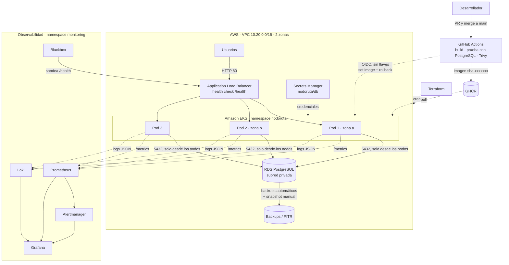

# Plan de trabajo — Despliegue de Nodo Ruta en AWS (5 ingenieros)

**Arquitectura** (la de `hackaton.md` §5.1): GitHub Actions → GHCR → Terraform (VPC en 2 zonas) → ALB → Amazon EKS (3 pods) → Amazon RDS PostgreSQL con backups · credenciales en AWS Secrets Manager · observabilidad con Prometheus, Loki, Grafana y Alertmanager.

**Cuenta:** AWS gratuita con 140 USD de créditos. **EKS, los nodos, el ALB y RDS cobran por hora aunque nadie los use**: se encienden al empezar la sesión y se destruyen al terminarla. Nada queda prendido de un día para otro.



---

## Resumen del reparto

| | Rol | Es dueño de | Pruebas que lidera | Documento que entrega |
|---|---|---|---|---|
| **I1** | Infraestructura y costos | Cuenta AWS, `terraform/` (VPC, EKS, ALB), `destruir.ps1` | I01 | `docs/01-infraestructura.md`, `docs/costos.md` |
| **I2** | Datos, secretos y recuperación | `terraform/rds.tf`, Secrets Manager, `restaurar_rds.ps1` | I05 | `docs/02-datos-recuperacion.md` |
| **I3** | Aplicación y CI/CD | `app/`, `.github/workflows/`, GHCR | Mala versión → rollback | `docs/03-cicd.md` |
| **I4** | Kubernetes y operación | `k8s/` (app), `desplegar.ps1`, `local/` | I02, I03, I04 | `docs/04-runbook.md` |
| **I5** | Observabilidad y evidencias | `k8s/monitoring/`, `PLANTILLA_EVIDENCIAS.md` | I06 y medición de todos los RTO | `docs/05-observabilidad.md` |

## Calendario y entregas entre personas

| Momento | I1 | I2 | I3 | I4 | I5 |
|---|---|---|---|---|---|
| **Sesión 0** (antes, sin gastar créditos) | Paso 0 · cuenta, usuarios IAM, presupuesto, `terraform plan` | Paso 0 · revisar `rds.tf` y ensayar I05 en local | Paso 0 · PR, pipeline en verde, imagen pública en GHCR | Paso 0 · ensayo local completo I01–I05 | Paso 0 · preparar *values*, dashboard y alertas en Kubernetes local |
| **Sesión 1 · 0:00** | `terraform apply` (~20 min) | Mira el apply con I1 | Prepara la variable en GitHub | Prepara terminales | Prepara Helm |
| **0:25** | ➜ avisa "clúster listo" y pasa el ARN del rol a I3 | Verifica RDS y toma el snapshot | Configura `AWS_DEPLOY_ROLE_ARN` | `desplegar.ps1` ➜ comparte la URL del ALB | Instala la observabilidad |
| **0:50** | **I01** | Guarda el estado inicial (hash) | Prueba el CD (despliegue automático) | Verifica los targets | Dashboard listo ➜ avisa "a medir" |
| **1:10** | Apoya | Apoya | Prueba **mala versión** | **I02 → I03 → I04** | Mide el RTO de cada una |
| **2:00** | Apoya | **I05** (20–30 min) | Apoya | Apoya | Mide el RTO de I05 |
| **2:40** | Apoya | Apoya | Ejecuta **I06** con el runbook | Observa sin ayudar | Registra **I06** |
| **3:20** | Revisa la facturación del día | Documenta | Documenta | Documenta | Consolida evidencias |
| **3:45** | **`destruir.ps1`** y revisión en la consola | | | | |
| **Sesión 2** (encuentro 3) | Costos reales y su mejora | External Secrets o Multi-AZ | HTTPS o canary | Mejora de capacidad | Pitch y presentación |

---

## Paso 0 — Todos (30 min, antes de la sesión 1)

1. Instalar las herramientas (PowerShell como administrador):
   ```powershell
   winget install -e --id Amazon.AWSCLI
   winget install -e --id Hashicorp.Terraform
   winget install -e --id Helm.Helm
   winget install -e --id Kubernetes.kubectl
   winget install -e --id Docker.DockerDesktop
   winget install -e --id Git.Git
   winget install -e --id Python.Python.3.13
   winget install -e --id Microsoft.PowerShell
   ```
   Cerrar y abrir la terminal. Verificar: `aws --version; terraform -version; helm version; kubectl version --client; docker version; python --version; pwsh --version`.
2. Clonar el repositorio (**no usar el ZIP**) y trabajar siempre por rama y PR:
   ```powershell
   git clone https://github.com/Andres062004/Los-Jensen.git
   cd Los-Jensen
   git checkout feat/despliegue-aws   # hasta que se fusione en main
   ```
3. Cuando I1 les entregue su usuario IAM: `aws configure` (llave de acceso, región `us-east-1`, salida `json`) y comprobar con `aws sts get-caller-identity`.
4. Leer este plan, la guía (`GUIA_ESTUDIANTE.md`) y la sección 5 de `hackaton.md`.
5. Scripts que usará todo el equipo:
   - `scripts/sondear.ps1`: una consulta por segundo; registra hora, código HTTP e instancia, y al final resume la ventana de error.
   - `scripts/verificar_servicio.py`: script oficial de evidencias de la guía.

**Reglas comunes**
- Nunca subir `terraform.tfstate`, `*.tfvars`, `.env`, contraseñas ni llaves de acceso (ya están en `.gitignore`). No pegar secretos en el chat del equipo.
- Solo I1 ejecuta `terraform apply` o `destroy`, y desde una sola máquina.
- Cada evidencia se guarda en `evidencias/` con el nombre indicado, sin sobrescribir otra. Si una prueba se repite, se agrega `_r2`.
- Cada prueba tiene su ficha en `PLANTILLA_EVIDENCIAS.md`: objetivo, pasos, resultado esperado, resultado observado, inicio/fin/RTO, evidencia y estado (cumple / parcial / no cumple).
- En la documentación se separa lo que **se probó** de lo que quedó **como diseño**.

---

## I1 · Infraestructura y costos

**Misión:** que el clúster exista, sea accesible para el equipo, cueste lo mínimo y desaparezca al final.

### Sesión 0
1. **Seguridad de la cuenta:**
   - Activar MFA en el usuario raíz y dejar de usarlo.
   - Crear el grupo `nodoruta-admin` con `AdministratorAccess` (solo para I1, porque Terraform necesita crear roles IAM).
   - Crear el grupo `nodoruta-equipo` con `PowerUserAccess`.
2. **Crear 5 usuarios IAM**, con acceso a la consola, llave de acceso y MFA obligatorio: `i1-infra`, `i2-datos`, `i3-cicd`, `i4-k8s`, `i5-obs`. Entregar a cada persona sus credenciales por un canal privado, nunca por el grupo del equipo. Anotar el ARN de cada uno (`arn:aws:iam::<cuenta>:user/<nombre>`).
3. **Presupuesto:** *Billing and Cost Management → Budgets → Create budget → Cost budget*, mensual, 140 USD, con alertas por correo al 10 %, 35 % y 70 % (~14, ~50 y ~100 USD). Agregar los correos de los 5.
4. **Revisar el plan de la cuenta.** En *Billing → Free plan* comprobar si la cuenta está en plan gratuito y si permite EKS y el tipo de instancia `t3.medium`. Si el plan gratuito bloquea EKS, hay que pasar al plan pagado; los créditos se siguen usando. Anotar la decisión y el motivo en `docs/01-infraestructura.md`.
5. **Preparar Terraform:**
   ```powershell
   cd terraform
   copy terraform.tfvars.example terraform.tfvars
   # editar: admin_cidrs con las IP públicas del equipo (https://checkip.amazonaws.com)
   #         equipo_admin_arns con los ARN de i2..i5
   terraform init
   terraform plan -out plan.tfplan
   ```
   Revisar el plan con I2 (la parte de RDS) y guardar el resumen (`Plan: N to add`) en `evidencias/terraform_plan.txt`.
6. **Estimar costos** con AWS Pricing Calculator (https://calculator.aws). No inventar precios: guardar el enlace de la estimación. Conceptos: plano de control de EKS (hora), 2 nodos EC2 `t3.medium` (hora), ALB (hora + LCU), IPv4 públicas (hora), RDS `db.t4g.micro` Single-AZ (hora + 20 GB gp3 + backups), Secrets Manager (secreto/mes), transferencia de datos. Calcular el costo de **una sesión de 4 h** y el de **24 h por error**.

### Sesión 1
7. Aplicar (~15–20 min):
   ```powershell
   terraform apply plan.tfplan
   terraform output
   ```
8. Verificar y guardar la evidencia en `evidencias/nube_infra.txt`:
   ```powershell
   aws eks update-kubeconfig --region us-east-1 --name nodoruta-eks
   kubectl get nodes -L topology.kubernetes.io/zone        # 2 nodos Ready en zonas distintas
   kubectl -n kube-system get deploy aws-load-balancer-controller   # 1/1
   ```
9. **Entregas:**
   - Avisar "clúster listo".
   - Pasar a I3 el valor de `terraform output github_deploy_role_arn`.
   - Pedir a I2–I5 que ejecuten `aws eks update-kubeconfig ...` y `kubectl get nodes` para confirmar su acceso.
10. **Prueba I01** (cuando I4 comparta la URL):
    ```powershell
    python scripts/verificar_servicio.py http://<ALB>/pedidos --peticiones 20 --salida evidencias/nube_I01_inicio.json
    ```
    Cumple si las 20 respuestas son 200, aparecen **3 instancias distintas** y la versión es `datos-v1`. Pedir a otra persona que lo repita desde su PC (`nube_I01_otro_pc.json`).
11. Al cierre de la sesión: **`./scripts/destruir.ps1`**. Luego revisar en la consola que no quede nada: *EC2 → Load Balancers*, *EC2 → Instances*, *RDS → Databases y Snapshots*, *EKS*, *VPC*. Guardar `evidencias/nube_destroy.txt`.
12. Anotar en `docs/costos.md` la hora de encendido y de apagado de cada sesión y el consumo del día en *Billing → Bills* (se actualiza con algunas horas de retraso).

### Sesión 2 (encuentro 3)
13. Comparar el costo estimado con el real y proponer ahorros, por ejemplo nodos Spot, apagar fuera de horario o reemplazar EKS por k3s.
14. Preparar 1–2 minutos del pitch: arquitectura, costos y seguridad de la red.

**Listo cuando:** el clúster se crea y se destruye con un comando, los 5 tienen acceso, hay evidencia de I01 y `docs/01-infraestructura.md` y `docs/costos.md` están escritos.

---

## I2 · Datos, secretos y recuperación

**Misión:** que los datos vivan fuera de los contenedores, estén protegidos y se puedan **recuperar** con un tiempo medido.

### Sesión 0
1. Revisar `terraform/rds.tf` y `terraform/secrets-github.tf` con I1, y entender cada decisión:
   - subred privada;
   - `publicly_accessible = false`;
   - grupo de seguridad que solo acepta a los nodos;
   - cifrado;
   - `backup_retention_period`;
   - Single-AZ.
2. Ensayar I05 en local con el entorno de I4:
   ```powershell
   docker compose -f local/compose.yaml --env-file local/.env exec app1 python datos_db.py estado
   docker compose -f local/compose.yaml --env-file local/.env exec app1 python datos_db.py alterar
   docker compose -f local/compose.yaml --env-file local/.env exec app1 python datos_db.py simular-error
   docker compose -f local/compose.yaml --env-file local/.env exec app1 python datos_db.py cargar
   ```
3. Leer `scripts/restaurar_rds.ps1`. RDS **no restaura encima** de la base: crea una instancia nueva a partir de los backups (*point-in-time restore*). El script conecta la app a esa nueva instancia y mide el RTO.

### Sesión 1
4. Verificar la base y guardar la salida en `evidencias/nube_rds.txt`:
   ```powershell
   aws rds describe-db-instances --db-instance-identifier nodoruta-db --query "DBInstances[0].[DBInstanceStatus,PubliclyAccessible,MultiAZ,BackupRetentionPeriod,StorageEncrypted]"
   aws secretsmanager describe-secret --secret-id nodoruta/db --query "[Name,ARN]"   # sin mostrar el valor
   ```
5. Demostrar que la base **no** se alcanza desde Internet. Debe fallar:
   ```powershell
   $dbHost = aws rds describe-db-instances --db-instance-identifier nodoruta-db --query "DBInstances[0].Endpoint.Address" --output text
   Test-NetConnection $dbHost -Port 5432      # TcpTestSucceeded : False
   ```
6. Cuando I4 haya desplegado, guardar el estado inicial (versión y sha256):
   ```powershell
   kubectl -n nodoruta exec deploy/nodoruta -- python datos_db.py estado > evidencias/nube_estado_inicial.json
   ```
7. Tomar el **snapshot manual**:
   ```powershell
   aws rds create-db-snapshot --db-instance-identifier nodoruta-db --db-snapshot-identifier nodoruta-antes-pruebas
   aws rds wait db-snapshot-available --db-snapshot-identifier nodoruta-antes-pruebas
   ```
8. **Prueba I05** (I5 mide con Grafana mientras tanto):
   1. Anotar el punto de recuperación:
      ```powershell
      $t0 = (Get-Date).ToUniversalTime().ToString("yyyy-MM-ddTHH:mm:ssZ"); $t0
      ```
   2. Esperar a que `LatestRestorableTime` sea **posterior** a `$t0`. Suele tardar unos 5 minutos; hay que repetir el comando hasta que pase:
      ```powershell
      aws rds describe-db-instances --db-instance-identifier nodoruta-db --query "DBInstances[0].LatestRestorableTime"
      ```
   3. Dejar el sondeo corriendo en otra terminal:
      ```powershell
      ./scripts/sondear.ps1 -Url http://<ALB>/health -Segundos 1800 -Salida evidencias/nube_I05_sondeo.txt
      ```
   4. Alterar los datos y luego dañarlos:
      ```powershell
      kubectl -n nodoruta exec deploy/nodoruta -- python datos_db.py alterar        # versión -> datos-alterado
      python scripts/verificar_servicio.py http://<ALB>/pedidos --salida evidencias/nube_I05_alterado.json
      kubectl -n nodoruta exec deploy/nodoruta -- python datos_db.py simular-error  # /health -> 503
      python scripts/verificar_servicio.py http://<ALB>/health --salida evidencias/nube_I05_error.json
      ```
      Explicar por qué los 3 pods fallan a la vez: el fallo de datos es **compartido** y una réplica más no lo resuelve.
   5. Restaurar (10–20 min):
      ```powershell
      ./scripts/restaurar_rds.ps1 -Hora $t0 | Tee-Object evidencias/nube_I05_restauracion.txt
      ```
   6. Comprobar:
      ```powershell
      python scripts/verificar_servicio.py http://<ALB>/pedidos --salida evidencias/nube_I05_restaurado.json
      ```
      Cumple si la versión vuelve a ser `datos-v1` y el **sha256 coincide** con el de `nube_estado_inicial.json`. Anotar el RTO que imprime el script y el RPO (`$t0` frente a la hora del daño).
9. **Después de restaurar no se ejecuta `terraform apply`**, porque Terraform volvería a apuntar el secreto a la base original. `destruir.ps1` borra la copia restaurada.

### Sesión 2 (encuentro 3)
10. Implementar una mejora:
    - **(a) External Secrets Operator:** instalarlo con Helm, darle un rol IRSA de solo lectura sobre `nodoruta/db`, crear un `ClusterSecretStore` y un `ExternalSecret` que generen el Secret `nodoruta-db`, y quitar del script `desplegar.ps1` la creación manual del Secret.
    - **(b) Propuesta Multi-AZ:** activar `multi_az = true`, explicar qué falla cubre, estimar su costo con la calculadora y medir el tiempo de *failover* (`aws rds reboot-db-instance --force-failover`).
11. Preparar 1–2 minutos del pitch: datos, respaldo, RTO y RPO medidos, y puntos únicos de falla.

**Listo cuando:** existe la evidencia de que la base es privada, el snapshot y la prueba I05 completa con sha256 coincidente y RTO medido, y `docs/02-datos-recuperacion.md` explica la restauración, el RPO, el RTO y las limitaciones.

---

## I3 · Aplicación y CI/CD

**Misión:** que ningún cambio roto llegue a producción y que, si llega, se vuelva atrás solo.

### Sesión 0
1. Quien tiene hoy la rama `feat/despliegue-aws` la sube y abre el PR hacia `main`. I3 es el responsable del PR.
   ```powershell
   git add . ; git commit -m "feat: despliegue en AWS (EKS, RDS, CI/CD)" ; git push -u origin feat/despliegue-aws
   ```
2. En el PR debe pasar el job **`ci`**: construcción, prueba de humo contra PostgreSQL (6 pedidos, `datos-v1`, cabecera `X-Instancia`, 503 con datos dañados) y escaneo Trivy.
   - Si Trivy falla por vulnerabilidades de la imagen base: actualizar `python:3.13-slim` o documentar la excepción en un `.trivyignore` con su justificación.
3. Proteger `main`: *Settings → Branches → Add rule → main*, con "Require a pull request" y "Require status checks: ci". Captura en `evidencias/github_proteccion_main.png`.
4. Fusionar el PR. Comprobar en *Actions* que se publicaron `ghcr.io/andres062004/los-jensen:main` y `:sha-xxxxxxx`.
5. **Hacer pública la imagen** para que EKS la descargue sin credenciales. Lo hace el dueño del repo o un administrador: *github.com/Andres062004 → Packages → los-jensen → Package settings → Change visibility → Public*. Verificar sin sesión iniciada:
   ```powershell
   docker logout ghcr.io ; docker pull ghcr.io/andres062004/los-jensen:main
   ```
6. Crear el environment: *Settings → Environments → New environment → `produccion`*, con *Required reviewers* = 2 compañeros.

### Sesión 1
7. Con el ARN que entrega I1: *Settings → Secrets and variables → Actions → Variables → New repository variable* → `AWS_DEPLOY_ROLE_ARN` = `arn:aws:iam::...:role/nodoruta-github-deploy`.
8. **Probar el CD** (después del primer despliegue de I4, porque el pipeline actualiza un Deployment que ya debe existir):
   - Hacer un PR pequeño, por ejemplo agregar `"version_app": "1.1"` a la respuesta de `/` en `app/app.py`.
   - Fusionarlo y aprobar el despliegue en el environment.
   - Verificar la nueva imagen con `kubectl -n nodoruta get deploy nodoruta -o jsonpath="{..image}"` → `...:sha-xxxxxxx`.
   - Guardar el log del job `deploy` y `kubectl -n nodoruta rollout history deployment/nodoruta` en `evidencias/nube_cd.txt`.
9. **Prueba "mala versión"** (dos partes):
   - **A. CI bloquea:**
     - Rama `prueba/rompe-health` donde `/health` siempre responde 503.
     - Abrir el PR: el job `ci` debe quedar en rojo y GitHub no deja fusionar.
     - Captura en `evidencias/nube_mala_version_ci.png`. Cerrar el PR sin fusionar.
   - **B. El clúster se protege y se revierte:**
     - Con el sondeo corriendo (`./scripts/sondear.ps1 -Url http://<ALB>/pedidos -Segundos 240 -Salida evidencias/nube_mala_version_sondeo.txt`), ejecutar:
       ```powershell
       kubectl -n nodoruta set image deployment/nodoruta app=ghcr.io/andres062004/los-jensen:no-existe
       kubectl -n nodoruta rollout status deployment/nodoruta --timeout=60s   # falla: ImagePullBackOff
       kubectl -n nodoruta get pods                                           # los 3 pods viejos siguen Running
       kubectl -n nodoruta rollout undo deployment/nodoruta
       kubectl -n nodoruta rollout status deployment/nodoruta
       ```
     - Cumple si el sondeo **no muestra errores**: `maxUnavailable: 0` mantiene las 3 réplicas sanas. Explicar que el job `deploy` hace este mismo `rollout undo` de forma automática.
10. Ejecutar la prueba **I06** (ver I5): seguir `docs/04-runbook.md` desde su PC sin ayuda de I4.

### Sesión 2 (encuentro 3)
11. Implementar una mejora:
    - **(a) HTTPS:** si el equipo consigue un dominio, pedir un certificado en ACM, validarlo por DNS y agregar al Ingress `alb.ingress.kubernetes.io/certificate-arn`, `listen-ports: '[{"HTTP":80},{"HTTPS":443}]'` y `ssl-redirect: '443'`.
    - **(b) Canary:** con Argo Rollouts (10 % → 50 % → 100 % con pausa) o con dos Deployments y pesos en el ALB.
12. Preparar 1–2 minutos del pitch: flujo de cambio a producción y demo del rollback.

**Listo cuando:** `main` está protegida, el pipeline está en verde, la imagen es pública, el despliegue automático funciona y existen las evidencias A y B de mala versión y `docs/03-cicd.md` explica el flujo, los secretos y el OIDC.

---

## I4 · Kubernetes y operación

**Misión:** que el servicio quede desplegado con 3 réplicas que sobreviven a caídas, y que cualquiera pueda recrearlo.

### Sesión 0
1. Ensayo local completo (sin costo):
   ```powershell
   copy local\.env.example local\.env     # poner una contraseña propia
   python scripts/datos.py preparar        # copia de trabajo exigida por la guía
   docker compose -f local/compose.yaml --env-file local/.env up -d --build
   docker compose -f local/compose.yaml --env-file local/.env ps   # app1..3 healthy
   python scripts/verificar_servicio.py --esperadas app1,app2,app3 --salida evidencias/local_I01.json
   docker compose -f local/compose.yaml --env-file local/.env stop app1
   python scripts/verificar_servicio.py --esperadas app2,app3 --salida evidencias/local_I02.json
   docker compose -f local/compose.yaml --env-file local/.env start app1   # esperar ~20 s
   python scripts/verificar_servicio.py --esperadas app1,app2,app3 --salida evidencias/local_I03.json
   docker compose -f local/compose.yaml --env-file local/.env up -d --force-recreate app1
   python scripts/verificar_servicio.py --salida evidencias/local_I04.json   # sigue en datos-v1
   ```
   Al terminar: `docker compose -f local/compose.yaml --env-file local/.env down`.
2. Leer `k8s/` y poder explicar cada decisión:
   - 3 réplicas;
   - `maxUnavailable: 0`;
   - `topologySpreadConstraints` por zona;
   - readiness en `/health` y liveness en `/vivo` (para no reiniciar los pods si cae la base);
   - PDB `minAvailable: 2`;
   - contenedor sin root y de solo lectura;
   - `target-type: ip` del ALB.

### Sesión 1
3. Con el aviso de I1 y la imagen pública de I3, desplegar y guardar la evidencia:
   ```powershell
   ./scripts/desplegar.ps1 | Tee-Object evidencias/nube_despliegue.txt
   kubectl get nodes -L topology.kubernetes.io/zone > evidencias/nube_pods_inicial.txt
   kubectl -n nodoruta get pods -o wide >> evidencias/nube_pods_inicial.txt
   ```
   Cumple si hay 3 pods `Running 1/1`, repartidos en los 2 nodos y zonas.
4. Verificar que el ALB ve 3 *targets* sanos: *EC2 → Target Groups → k8s-nodoruta-...* → 3 `healthy` (captura en `evidencias/nube_targets.png`).
5. **Compartir la URL del ALB** con el equipo y fijarla en el chat.
6. **Prueba I02a · caída de un pod** (2 terminales; I5 mide):
   ```powershell
   # Terminal 1
   ./scripts/sondear.ps1 -Url http://<ALB>/pedidos -Segundos 120 -Salida evidencias/nube_I02_pod.txt
   # Terminal 2 (unos 10 s después)
   kubectl -n nodoruta get pods
   kubectl -n nodoruta delete pod <nombre-de-un-pod>
   kubectl -n nodoruta get pods -w        # ver cómo se crea el reemplazo
   ```
7. **Prueba I02b · caída de un nodo o zona:**
   ```powershell
   # Terminal 1
   ./scripts/sondear.ps1 -Url http://<ALB>/pedidos -Segundos 300 -Salida evidencias/nube_I02_nodo.txt
   # Terminal 2
   kubectl get nodes
   kubectl drain <nodo> --ignore-daemonsets --delete-emptydir-data
   kubectl -n nodoruta get pods -o wide   # todos en el otro nodo, el servicio sigue
   ```
8. **Prueba I03 · recuperación:**
   ```powershell
   kubectl uncordon <nodo>
   kubectl -n nodoruta rollout restart deployment/nodoruta   # para volver a repartir los pods entre zonas
   kubectl -n nodoruta get pods -o wide > evidencias/nube_I03_recuperado.txt
   python scripts/verificar_servicio.py http://<ALB>/pedidos --peticiones 20 --salida evidencias/nube_I03.json
   ```
   Cumple si vuelven 3 instancias distintas. Registrar cuánto tardó.
9. **Prueba I04 · recrear conserva los datos:**
   ```powershell
   ./scripts/sondear.ps1 -Url http://<ALB>/pedidos -Segundos 120 -Salida evidencias/nube_I04_sondeo.txt   # terminal 1
   kubectl -n nodoruta rollout restart deployment/nodoruta                                               # terminal 2
   python scripts/verificar_servicio.py http://<ALB>/pedidos --salida evidencias/nube_I04.json
   ```
   Cumple si los nombres de los pods son nuevos y siguen `datos-v1` y los 6 pedidos, porque los datos están en RDS y no en la imagen.
10. Escribir **`docs/04-runbook.md`** para que otra persona, sin ayuda, pueda:
    - (a) configurar su acceso;
    - (b) desplegar desde cero;
    - (c) recuperar un pod o un nodo;
    - (d) revertir una versión;
    - (e) restaurar los datos (enlazar a I2).
    Debe incluir comandos exactos y qué se espera ver en cada paso.

### Sesión 2 (encuentro 3)
11. Implementar una mejora: HPA (`kubectl autoscale deployment nodoruta --min=3 --max=6 --cpu-percent=70`, requiere `metrics-server`) o un tercer nodo y Cluster Autoscaler. Medir el efecto.
12. Preparar 1–2 minutos del pitch: demo en vivo de la caída de un pod.

**Listo cuando:** el despliegue funciona con un comando, existen las evidencias de I02a, I02b, I03 e I04 y el runbook se ha usado con éxito en I06.

---

## I5 · Observabilidad y evidencias

**Misión:** que el equipo **vea** lo que pasa, que se **mida** el RTO de cada prueba y que todas las evidencias queden ordenadas.

### Sesión 0 (ensayar en Kubernetes local: *Docker Desktop → Settings → Kubernetes → Enable*)
1. Crear en `k8s/monitoring/`:
   - **`kps-values.yaml`** para `kube-prometheus-stack`:
     - `prometheus.prometheusSpec.retention: 24h`;
     - `serviceMonitorSelectorNilUsesHelmValues: false` y `probeSelectorNilUsesHelmValues: false`, para que lea los ServiceMonitor y Probe propios;
     - sin persistencia;
     - recursos pequeños;
     - contraseña de Grafana leída de un Secret (`grafana.admin.existingSecret`).
   - **`loki-values.yaml`** para `grafana/loki`:
     - `deploymentMode: SingleBinary` con 1 réplica;
     - almacenamiento `filesystem`;
     - `auth_enabled: false`;
     - `schemaConfig` tsdb v13;
     - sin `gateway`, `lokiCanary` ni caché, para ahorrar pods.
   - **`alloy-values.yaml`** para `grafana/alloy`: recolectar los logs de los pods del namespace `nodoruta` y enviarlos a Loki.
   - **`servicemonitor-nodoruta.yaml`**: selector `app: nodoruta`, puerto `http`, ruta `/metrics`, cada 15 s.
   - **`probe-alb.yaml`**: objeto `Probe` del Blackbox exporter, módulo `http_2xx`, objetivo `http://<ALB>/health`, cada 5 s.
   - **`alertas-nodoruta.yaml`** (`PrometheusRule`):
     | Alerta | Expresión | `for` |
     |---|---|---|
     | `InstanciaNoDisponible` | `kube_deployment_status_replicas_available{namespace="nodoruta",deployment="nodoruta"} < 3` | 1m |
     | `ServicioCaido` | `probe_success{job="probe/monitoring/alb"} == 0` | 30s |
     | `TasaErrores5xx` | `sum(rate(nodoruta_requests_total{status=~"5.."}[2m])) / sum(rate(nodoruta_requests_total[2m])) > 0.05` | 2m |
     | `VersionDatosInconsistente` | `count(count by (version_datos) (nodoruta_datos_info)) > 1` | 1m |
   - Receptor de Alertmanager: un webhook de Discord o Slack del equipo, o https://webhook.site para la demo. La URL va en un Secret, no en el repositorio.
2. Script `scripts/monitoring-install.ps1`:
   ```powershell
   helm repo add prometheus-community https://prometheus-community.github.io/helm-charts
   helm repo add grafana https://grafana.github.io/helm-charts
   helm repo update
   kubectl create namespace monitoring
   kubectl -n monitoring create secret generic grafana-admin --from-literal=admin-user=admin --from-literal=admin-password=<generar>
   helm upgrade --install kps prometheus-community/kube-prometheus-stack -n monitoring -f k8s/monitoring/kps-values.yaml
   helm upgrade --install loki grafana/loki -n monitoring -f k8s/monitoring/loki-values.yaml
   helm upgrade --install alloy grafana/alloy -n monitoring -f k8s/monitoring/alloy-values.yaml
   helm upgrade --install blackbox prometheus-community/prometheus-blackbox-exporter -n monitoring
   kubectl apply -f k8s/monitoring/servicemonitor-nodoruta.yaml -f k8s/monitoring/probe-alb.yaml -f k8s/monitoring/alertas-nodoruta.yaml
   ```
3. Dashboard **"Nodo Ruta · Continuidad"**, exportado a `k8s/monitoring/dashboard-nodoruta.json`:
   | Panel | Consulta |
   |---|---|
   | Disponibilidad (15 min) | `avg_over_time(probe_success{job="probe/monitoring/alb"}[15m]) * 100` |
   | Pods Ready | `sum(kube_pod_status_ready{namespace="nodoruta",condition="true"})` |
   | Solicitudes por instancia | `sum by (pod) (rate(nodoruta_requests_total{ruta="/pedidos"}[1m]))` |
   | % errores 5xx | `sum(rate(nodoruta_requests_total{status=~"5.."}[2m])) / sum(rate(nodoruta_requests_total[2m])) * 100` |
   | Latencia p95 | `histogram_quantile(0.95, sum by (le) (rate(nodoruta_request_duration_seconds_bucket[5m])))` |
   | Versión de datos por pod | `nodoruta_datos_info` (tabla: pod, version_datos) |
   | Sondeo externo | `probe_success{job="probe/monitoring/alb"}` (línea de tiempo) |
   | Logs con error (Loki) | `{namespace="nodoruta"} \| json \| status >= 500` |

   El `job` de las consultas del sondeo depende del nombre del objeto Probe: hay que confirmarlo en *Prometheus → Status → Targets*.

### Sesión 1
4. Después del despliegue de I4: poner la URL del ALB en `probe-alb.yaml`, ejecutar `./scripts/monitoring-install.ps1` y abrir Grafana:
   ```powershell
   kubectl -n monitoring port-forward svc/kps-grafana 3000:80    # http://localhost:3000
   ```
   Si quedan pods en `Pending` por falta de capacidad, avisar a I1 para subir `node_count` a 3.
5. Comprobar que llegan los datos:
   - *Prometheus → Targets*: los 3 pods de `nodoruta` en `UP`.
   - En el panel de logs aparecen las líneas JSON.
6. **Medir el RTO de cada prueba.** Para cada una:
   - poner una **anotación** en Grafana al iniciar;
   - tomar el tiempo desde el primer `probe_success = 0` (o la caída de Pods Ready) hasta la recuperación;
   - hacer una captura del dashboard (`evidencias/grafana_<prueba>.png`);
   - comparar con el resumen de `sondear.ps1`.
7. Disparar una alerta real, por ejemplo `InstanciaNoDisponible` durante I02, y guardar la captura de la notificación recibida.
8. **Prueba I06:** I3 sigue `docs/04-runbook.md` desde su PC sin ayuda: elimina el Deployment (`kubectl -n nodoruta delete deploy nodoruta`) y lo recrea con `desplegar.ps1`. I5 registra el tiempo, los pasos que fallaron o no estaban claros y el resultado. Lo que falle se corrige en el runbook y se repite (`_r2`).
9. **Consolidar `PLANTILLA_EVIDENCIAS.md`:** una ficha por prueba (I01–I06 y mala versión), con enlaces a los archivos de `evidencias/` y estado (cumple / parcial / no cumple). Pedir a cada dueño su ficha antes de cerrar la sesión.

### Sesión 2 (encuentro 3)
10. Armar la presentación del pitch: problema, arquitectura, demo (I4 y I3), resultados con RTO y capturas, costos (I1), limitaciones y mejoras. Coordinar los tiempos de cada uno.

**Listo cuando:** el dashboard muestra los 8 paneles con datos reales, hay al menos una alerta recibida, todas las pruebas tienen RTO medido y ficha completa, existe la evidencia de I06 y `docs/05-observabilidad.md` está escrito.

---

## Matriz de pruebas

| Prueba | Qué demuestra | Dueño | Mide | Evidencias |
|---|---|---|---|---|
| I01 | Acceso común, 3 instancias, `datos-v1` | I1 | I5 | `nube_I01_inicio.json`, `nube_I01_otro_pc.json` |
| I02a | Cae un pod, el servicio sigue | I4 | I5 | `nube_I02_pod.txt`, `grafana_I02a.png` |
| I02b | Cae un nodo o zona, el servicio sigue | I4 | I5 | `nube_I02_nodo.txt`, `grafana_I02b.png` |
| I03 | Vuelven las 3 réplicas | I4 | I5 | `nube_I03.json`, `nube_I03_recuperado.txt` |
| I04 | Recrear pods conserva los datos | I4 | I5 | `nube_I04.json`, `nube_I04_sondeo.txt` |
| I05 | Daño de datos → 503 → restaurar RDS → hash igual | I2 | I5 | `nube_I05_*.json/txt`, `grafana_I05.png` |
| Extra | Mala versión: CI la bloquea y el clúster la revierte | I3 | I5 | `nube_mala_version_*` |
| I06 | Otro integrante recrea el servicio con el runbook | I5 (registra), I3 (ejecuta) | I5 | `nube_I06.txt` |

## Puntos únicos de falla a declarar (todos deben poder explicarlos)
- **RDS Single-AZ:** si cae su zona, no hay datos hasta restaurar. Mejora: Multi-AZ (I2).
- **Un ALB en una región:** el ALB de AWS es redundante entre zonas; una caída de toda la región no está cubierta.
- **Nodos en subredes públicas sin NAT:** se eligió así por costo; el aislamiento lo dan los grupos de seguridad. Mejora: subredes privadas con NAT o VPC endpoints.
- **Estado de Terraform local** en la máquina de I1. Mejora: backend S3 con bloqueo.
- **HTTP sin TLS** si no hay dominio. Mejora: ACM y HTTPS (I3).
