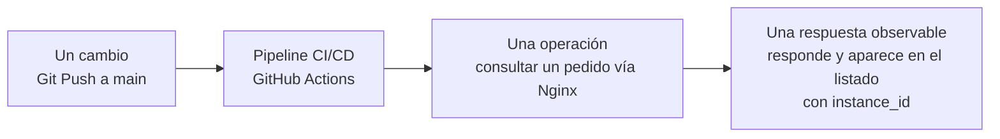
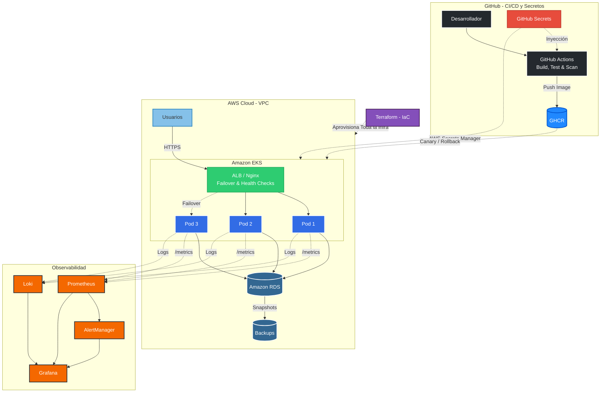
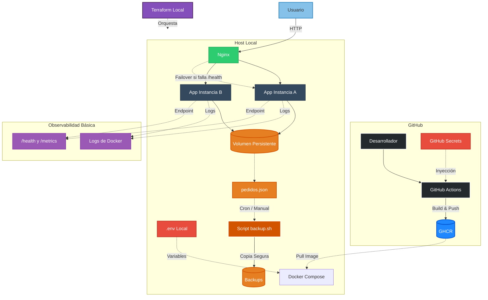
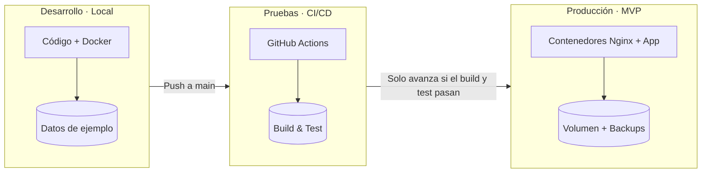

# Nodo Ruta - Servicio de Consultas y Despliegue Continuo

Servicio de consulta de estado de entregas para distribución urbana, diseñado con una arquitectura orientada a la alta disponibilidad, automatización y observabilidad.

**Versión del README:** 1.0 · **Autoría:** Santiago Zapata · **Última revisión:** 21/11/2026

---

## 1. Qué es y para quién

Un servicio para consultar el estado de una entrega y ver los pedidos del día. El sistema está diseñado no solo para funcionar, sino para **mantenerse disponible durante cambios y fallos**.

- **Ámbito:** logística y distribución urbana.
- **Quién lo usa:** el equipo de operaciones (consulta entregas) y el responsable técnico (publica versiones y atiende incidentes).
- **Quién no lo usa:** los clientes finales. Ellos reciben la información por el equipo de operaciones.
- **Qué necesita poder hacer quien lo usa:** consultar el estado de un pedido con certeza, y que el servicio siga disponible durante cambios y fallos.

## 2. Qué puede fallar y cómo lo resolvemos

| Cuando cambia… | Qué deja de funcionar | Quién lo nota | Cómo lo resolvemos en este proyecto |
|---|---|---|---|
| El servicio se actualiza con un error | Las consultas dejan de responder | El equipo de operaciones | **CI/CD con GitHub Actions** que valida antes de desplegar y permite rollback rápido. |
| La instancia que atiende se detiene | El servicio queda sin respuesta | El equipo de operaciones | **Nginx con Failover** y Health Checks que redirigen el tráfico a la instancia sana. |
| Se pierde o se modifica el archivo de datos | Las consultas devuelven datos vacíos o incorrectos | El equipo de operaciones y la coordinación logística | **Volumen persistente** (separado del contenedor) y **Script de backups** con retención. |

## 3. El servicio pequeño

El más chico que representa el problema: **consultar el estado de un pedido** y **ver los pedidos del día**.

- **Qué entra:** 6 pedidos ficticios con un identificador de versión de los datos.
- **Operación que muestra su valor:** consultar un pedido.
- **Respuesta observable:** la consulta devuelve el estado, el listado del día y el `instance_id` de la instancia que atendió.
- **Si el servicio no responde:** el proxy Nginx detecta la falla y la otra instancia atiende la consulta (continuidad).
- **Por qué es una muestra válida:** contiene lo que más afecta si falla (consultar) y lo que permite verificarlo (listar y reconocer qué instancia atendió).

## 4. Recorrido mínimo

1. **Un cambio:** se actualiza el código y se hace push a la rama `main`.
2. **Una operación:** GitHub Actions construye la imagen, la publica y el entorno local la descarga.
3. **Una respuesta observable:** la consulta responde y el listado muestra el pedido, con el `instance_id` de la instancia que atendió.

## 5. Arquitectura y Decisiones Técnicas

Para garantizar la reproducibilidad y la continuidad, el proyecto se divide en dos capas: **la visión de producción (AWS)** y el **MVP funcional (Local)**.

### 5.1. Visión de Producción (Diseño Cloud)

Diseñado para escalar y resistir fallos de infraestructura. Utiliza **Terraform** para aprovisionar la VPC, el clúster de **Amazon EKS** (Kubernetes) y **Amazon RDS** (PostgreSQL).

El tráfico se gestiona mediante un **Application Load Balancer (ALB)**, mientras que la observabilidad se delega a **Prometheus, Loki y Grafana**.

Los secretos se gestionan de forma segura mediante **AWS Secrets Manager**.

### 5.2. MVP de la Hackatón (Implementación Local)

Es la misma topología lógica que la visión de producción, pero adaptada a las restricciones del reto (sin costos y con almacenamiento en archivo JSON).

1. **Proxy Inverso:** Nginx distribuye la carga y maneja el failover (si una instancia falla, redirige a la otra).

2. **Aplicación:** Dos contenedores Docker (Python) que exponen los endpoints:
   - `/pedidos`
   - `/health`
   - `/metrics`

3. **Almacenamiento:** Volumen persistente en el host que guarda el archivo `pedidos.json`, separado del ciclo de vida de los contenedores.

4. **CI/CD:** GitHub Actions construye la imagen y la publica en GHCR.

5. **Secretos:** Uso de GitHub Secrets para el pipeline y un archivo `.env` local (ignorado en Git) para las variables de entorno.

6. **Observabilidad:** Logs en `stdout` y endpoint de métricas mediante `prometheus_client`.

### 5.2. MVP de la Hackatón (Implementación Local)

Es la misma topología lógica que la visión de producción, pero adaptada a las restricciones del reto (sin costos y con almacenamiento en archivo JSON).

1. **Proxy Inverso:** Nginx distribuye la carga y maneja el failover (si una instancia falla, redirige a la otra).

2. **Aplicación:** Dos contenedores Docker (Python) que exponen los endpoints:
   - `/pedidos`
   - `/health`
   - `/metrics`

3. **Almacenamiento:** Volumen persistente en el host que guarda el archivo `pedidos.json`, separado del ciclo de vida de los contenedores.

4. **CI/CD:** GitHub Actions construye la imagen y la publica en GHCR.

5. **Secretos:** Uso de GitHub Secrets para el pipeline y un archivo `.env` local (ignorado en Git) para las variables de entorno.

6. **Observabilidad:** Logs en `stdout` y endpoint de métricas mediante `prometheus_client`.

### 5.3. Tabla de Componentes y Responsabilidades

| Pieza | Qué es | Para qué sirve | Herramienta en MVP |
|--------|---------|----------------|--------------------|
| Punto de acceso común | Proxy Inverso | Recibe las consultas, distribuye la carga y realiza failover. | Nginx |
| Servicio de consultas | Aplicación | Responde los endpoints `/pedidos`, `/health` y `/metrics`, e informa el `instance_id`. | Python + Docker |
| Base de datos / archivo | Dependencia | Guarda los pedidos fuera del ciclo de vida del contenedor. | Volumen Docker + JSON |
| Respaldo | Copia externa | Permite recuperar los datos si se pierden o alteran. | `backup.sh` con timestamp |
| CI/CD | Automatización | Construye, prueba y publica la imagen para evitar errores manuales. | GitHub Actions |
| IaC | Infraestructura como Código | Permite recrear el entorno de forma reproducible. | Terraform |
| Secretos | Seguridad | Evita subir credenciales o claves al repositorio. | GitHub Secrets + `.env` |

---

### 5.4. Entornos y Flujo de Trabajo

1. **Desarrollo:** donde se realizan los cambios (rama local).

2. **Pruebas:** donde GitHub Actions verifica que la imagen se construye correctamente y que los health checks pasan.

3. **Producción:** donde el equipo de operaciones utiliza el sistema (entorno local simulado).

Una versión solo avanza si supera las pruebas automatizadas definidas en el pipeline.

## 6. Criterios de Aceptación y Pruebas

| # | Operación | Evidencia | Cómo lo resuelve la arquitectura |
|---|-----------|-----------|----------------------------------|
| 1 | Consultar un pedido a través del punto de acceso común | Otra persona obtiene el mismo resultado, con la versión y el `instance_id` anotados. | Nginx distribuye la carga entre las instancias. |
| 2 | Un cambio que deja el servicio sin poder consultar | La versión no avanza, o se vuelve a la anterior y la consulta funciona de nuevo. | El pipeline de CI/CD bloquea imágenes defectuosas y permite rollback. |
| 3 | Detener una instancia | La consulta sigue respondiendo. | Nginx detecta que `/health` falla y redirige a la instancia sana (failover). |
| 4 | Pérdida o alteración de datos | Se restaura el respaldo y el `version_id` vuelve a ser el esperado. | El volumen persiste fuera del contenedor y el script de backup permite la recuperación. |

### Pruebas de Aceptación Detalladas

#### Prueba A · Funcionamiento Normal

1. **Entrada:** consultar un pedido a través de Nginx.
2. **Se espera:** la consulta responde y el pedido aparece en el listado, junto con el `instance_id` de la instancia que atendió la solicitud.
3. **Cómo se comprueba:** se realiza un `curl` o se abre el navegador y se verifica la respuesta obtenida.

#### Prueba B · Fallo y Recuperación (Continuidad)

1. **Entrada:** detener una instancia (por ejemplo, `docker stop app1`) y volver a consultar.
2. **Se espera:** la consulta continúa respondiendo desde la instancia restante (failover de Nginx).
3. **Cómo se comprueba:** se detiene el contenedor, se realiza una nueva consulta y se verifica que el `instance_id` cambió al de la instancia activa.

#### Prueba C · Persistencia y Respaldo (Durabilidad)

1. **Entrada:** respaldar el archivo, alterar una copia de trabajo y restaurarla.
2. **Se espera:** tras restaurar, el `version_id` y el contenido vuelven a ser los esperados.
3. **Cómo se comprueba:** se ejecuta `backup.sh`, se modifica el JSON original, se restaura el respaldo y se compara el `version_id` y el hash del archivo.

---

